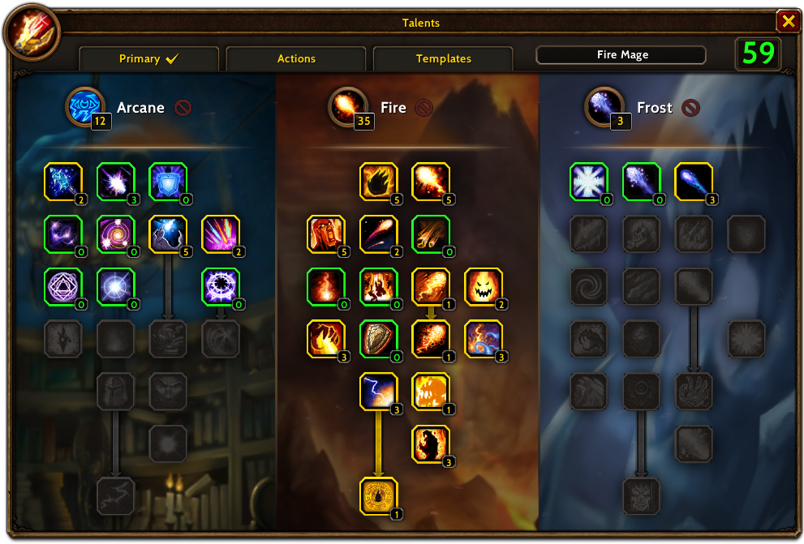

# TooManyTalents

**Blizzard's talent window, with templates, targets, and a more compact layout**

## Features

### Templates

- Plan builds for **any class**, from the **Templates** tab
- **Actions > Apply** learns a template in one go
- Set a template as your **target**, and your own talents show where you differ

### Sharing

- **Export** a template as a line of text, or **Import** one someone has sent you
- **Inspect Talents** on another player opens their build, copy into a template with one click

### Layout options

- **Space between trees** and **Space between talents** sliders for a more compact window.
- **Icons**, **Points** and **Arrows**: the classic square icons, rank badges and thick arrows.
- Shift-right-click on the window centres it on the screen.

## Credits

Inspired by Jerry's **Talented**, and Lethay who kept it going through Classic
